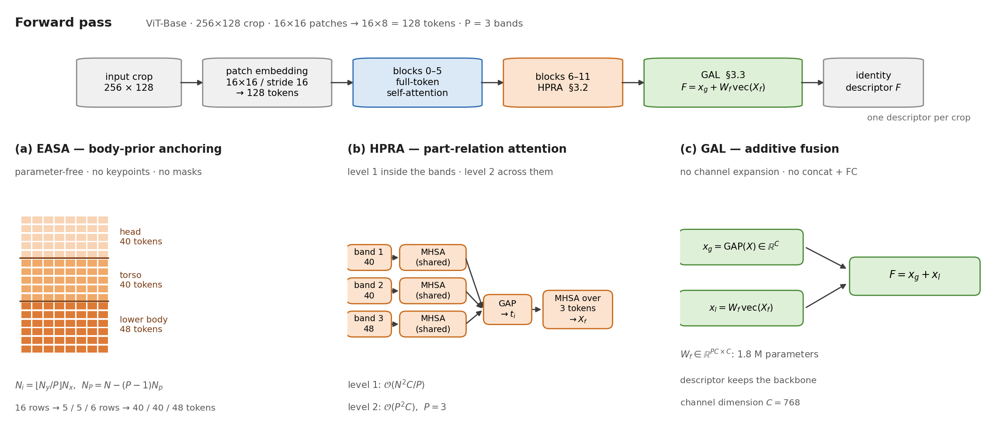

<div align="center">

# PBP-ReID

**Efficient Body-Prior Token Anchoring and Part-Aware Global–Local Fusion<br/>for Multi-Scene Person Re-Identification**

Peng Dong · Hongbin Liu · Xiuyi Guo · Jilong Li · Yitong Zhou · Baoxu Wang

[](https://www.python.org/)
[](https://pytorch.org/)
[](https://developer.nvidia.com/cuda-toolkit)
[](LICENSE)
[](https://link.springer.com/journal/371)
[]()

[Method](#method) · [Results](#results) · [Quick start](#quick-start) · [Efficiency](#efficiency) · [Reproducibility](#reproducibility-notes) · [Citation](#citation)

</div>

<p align="center">
  
</p>

---

## Why this model

Part-aware person re-identification normally pays for alignment twice: a pose
estimator or a segmentation network has to run for every crop, and the part
features are then concatenated and projected, which inflates the output
dimension. PBP-ReID removes both costs while keeping the part structure:

- **No alignment network.** The body prior is imposed on the ViT patch lattice by
  index arithmetic — no keypoints, no masks, no extra parameters.
- **Cheaper attention.** Inside the last six blocks, full-token self-attention is
  replaced by attention *within* three body bands, which reduces the number of
  attention-score entries from `N²` to `N²/P` (65 % fewer for `P = 3`).
- **No channel expansion.** The part-level descriptor is added to the global one
  instead of being concatenated, so the identity feature keeps the backbone
  dimension.
- **One training recipe.** The same model and loss cover standard, occluded,
  low-resolution, visible–infrared and clothing-changing benchmarks, in both the
  single-scene and the multi-scene training regime.

## Method

Three stages are added on top of a ViT-Base backbone (256×128 crop, 16×16
patches, 16×8 = 128 tokens, `P = 3` bands).

**EASA — parameter-free body-prior anchoring** (`model/modules/easa.py`)

The token sequence is cut into `P` contiguous row bands,

```
N_i = ⌊N_y / P⌋ · N_x  (i < P),      N_P = N − (P−1)·N_p
```

which gives 5 / 5 / 6 rows, i.e. 40 / 40 / 48 tokens for a 16×8 lattice. The
rule is applied after the detector has produced a normalised pedestrian crop, so
it anchors tokens in the crop coordinate system rather than estimating anatomy.

**HPRA — hierarchical part-relation attention** (`model/modules/hpra.py`)

*Level 1* applies multi-head self-attention inside every band with a **single set
of projections shared by all bands**, so the cost becomes `O(N²C/P)` instead of
`O(N²C)`. *Level 2* pools each refined band to one descriptor `t_i` and runs a
compact attention over the `P` descriptors, producing `X_f`.

**GAL — global–local additive fusion** (`model/modules/gal.py`)

```
x_g = GAP(X),      x_l = W_f · vec(X_f) + b_f,      F = x_g + x_l
```

Because the two terms share the channel dimension `C`, fusion needs neither a
concatenation nor a fully connected layer after it.

**Training.** Cross-entropy on the BNNeck feature plus a batch-hard triplet loss
on the backbone feature — nothing else. No scene prompt, no distillation stage.

## Results

Numbers **as reported in the manuscript** (mAP / Rank-1, %). Trained weights are
not released; see [Reproducibility notes](#reproducibility-notes).

**Single-scene regime** (one training set, one test set)

| Method | Market-1501 | MSMT17 | Occ-Duke | SYSU-MM01 | MLR-CUHK03 |
|---|---|---|---|---|---|
| TransReID | 81.0 / 92.5 | 35.8 / 57.8 | 60.0 / 73.5 | 36.9 / 38.6 | 85.5 / 90.3 |
| VersReID | 82.0 / 92.9 | 37.1 / 59.9 | 60.9 / 74.4 | 37.8 / 39.5 | 85.7 / 90.9 |
| **PBP-ReID** | **82.7 / 93.4** | **41.4 / 66.0** | **62.1 / 75.6** | **39.4 / 40.7** | **87.7 / 91.9** |

**Multi-scene regime** (union of training splits, unified label space)

| Method | Market-1501 | MSMT17 | Celeb-ReID | PRCC |
|---|---|---|---|---|
| TransReID | 78.5 / 91.8 | 38.2 / 61.8 | 7.0 / 47.1 | 36.9 / 51.4 |
| VersReID | 79.6 / 92.2 | 39.5 / 62.9 | 7.8 / 48.6 | 38.3 / 55.8 |
| **PBP-ReID** | **81.0 / 92.6** | **42.3 / 66.4** | **8.3 / 49.4** | **40.3 / 53.1** |

The largest gains appear on the benchmarks with the strongest domain or modality
shift (MSMT17, SYSU-MM01), which is consistent with a mechanism that regularises
the vertical structure of the descriptor rather than fitting dataset statistics.

## Quick start

```bash
git clone https://github.com/dongpeng011/PBP-ReID-Net.git
cd PBP-ReID-Net
pip install -r requirements.txt
```

**1. Verify the installation** — no data, no checkpoint needed:

```bash
python tools/smoke_test.py
```

This checks the band partition, the algebraic identity of Eq. (11), the four
ablation configurations and the loading of a ViT-Base checkpoint, then prints
`all checks passed`.

**2. Try the full pipeline on synthetic data** (about one minute):

```bash
python tools/make_dummy_dataset.py --layout market --root data/dummy_market
python train.py --config_file configs/PBP-ReID.yml \
    DATASETS.ROOTS "['data/dummy_market']" MODEL.PRETRAIN_CHOICE none \
    SOLVER.MAX_EPOCHS 2 SOLVER.IMS_PER_BATCH 8 DATALOADER.NUM_INSTANCE 4 \
    DATALOADER.NUM_WORKERS 0 SOLVER.EVAL_PERIOD 1 OUTPUT_DIR logs/demo
python test.py --config_file configs/PBP-ReID.yml \
    DATASETS.ROOTS "['data/dummy_market']" MODEL.PRETRAIN_CHOICE none \
    TEST.WEIGHT logs/demo/pbp_reid_2.pth OUTPUT_DIR logs/demo
```

**3. Train on a real benchmark.** Download the dataset, put a ViT-Base checkpoint
in `ckpts/`, edit `DATASETS.ROOTS` (or override it on the command line) and run:

```bash
python train.py --config_file configs/PBP-ReID.yml \
    MODEL.DEVICE_ID "('0')" OUTPUT_DIR logs/market1501
```

Mult-scene training uses `configs/PBP-ReID-multiscene.yml`, where the seven
training splits are combined under a unified label space.

## Ablations

Every component is a configuration switch — no code change is required:

| Configuration | Command flag |
|---|---|
| ViT-Base reference (no HPRA, no GAL) | `MODEL.HPRA_START 12 MODEL.GAL False` |
| + HPRA only | `MODEL.GAL False` |
| + GAL only | `MODEL.HPRA_START 12` |
| Full model | *(default)* |

`MODEL.HPRA_START` is the first block whose full-token attention is replaced by
HPRA (`6` = blocks 6–11, `12` = none). `bash/run_ablation.sh` runs all four.

## Efficiency

Measured with this repository on a single **RTX 3090**, one 256×128 crop, batch
64 (`python tools/measure_speed.py`):

| Model | Params (M) | Backbone (M) | FLOPs (G) | Latency (ms) | FPS |
|---|---|---|---|---|---|
| ViT-B reference | 86.32 | 85.75 | 22.68 | 1.52 | 659 |
| **PBP-ReID** | **88.10** | **87.53** | **22.46** | **1.55** | **647** |

The part-aware stages therefore cost about 1.8 M parameters and keep the
latency of the plain ViT-Base within a few percent, while the attention-score
work inside the HPRA blocks drops by 65 %.

## Repository structure

```
PBP-ReID-Net/
├── configs/               PBP-ReID.yml, PBP-ReID-multiscene.yml
├── config/                defaults.py + cfg_node.py (yacs fallback)
├── model/
│   ├── pbp_reid.py        ViT-Base + EASA + HPRA + GAL
│   ├── make_model.py      BNNeck + classifier
│   ├── vit_utils.py       attention kernel, patch embedding
│   └── modules/           easa.py · hpra.py · gal.py
├── datasets/              Market-1501 / MSMT17 / PRCC / ... loaders
├── loss/  solver/         CE + triplet, Adam + cosine schedule
├── processor/trainer.py   training and evaluation loops
├── utils/                 mAP / CMC / PRCC / SYSU metrics, logger
├── tools/                 smoke test, efficiency, synthetic data
├── bash/                  example scripts
├── docs/                  Chinese guide, verification log, figures
├── train.py  test.py
└── requirements.txt
```

## Configuration reference

| Key | Meaning | Default |
|---|---|---|
| `MODEL.PART_NUM` | number of body bands `P` | `3` |
| `MODEL.HPRA_START` | first block using HPRA | `6` |
| `MODEL.HPRA_HEADS` | heads of the intra-band attention | `12` |
| `MODEL.HPRA_REL_HEADS` | heads of the inter-band attention | `4` |
| `MODEL.HPRA_REL_SHARE` | share the projections of the two levels | `True` |
| `MODEL.GAL` | enable the additive fusion | `True` |
| `MODEL.PRETRAIN_PATH` | ViT-Base checkpoint | `ckpts/vit_base_patch16_224.pth` |
| `INPUT.SIZE_TRAIN` | crop size | `[256, 128]` |
| `DATASETS.COMBINE_NAMES` | training subsets (one = single-scene) | `['market1501']` |
| `DATASETS.COMBINE_TYPE` | scene id per subset | `[1]` |

## Reproducibility notes

Three quantitative statements of the paper are **not** reproduced by this code
and are documented here on purpose:

1. **Parameter count.** Eq. (10) uses `W_f ∈ ℝ^{PC×C}` (1.77 M), so the model has
   88.1 M parameters against 86.3 M for the ViT-Base reference. The 87.3 M of the
   paper corresponds to a `C×C` matrix shared across bands; the difference is
   exactly 0.8 M. The code keeps the `PC×C` form.
2. **Level-2 projections.** Eq. (8) names separate `W_Q', W_K', W_V'`
   (+14.2 M parameters). The paper's parameter count implies that these are
   shared with level 1, which is the default here; set
   `MODEL.HPRA_REL_SHARE False` for the literal reading of Eq. (8).
3. **FLOPs.** At 128 tokens, attention is only ≈2.7 % of a ViT-Base block, so
   replacing 66 % of it in six blocks saves ≈1 % of the total FLOPs
   (22.68 → 22.46 G), not the 16 % listed in Table 4 of the paper. The 65 %
   reduction of Table 1 refers to **attention-score entries**, which is what the
   code implements; wall-clock latency stays at parity with ViT-Base.

Everything else — the anchoring rule, both attention levels, the additive
fusion, the losses, the two training regimes and the metrics — follows the paper
as written. A step-by-step log of the checks that were run before release is in
[`docs/verification_log.md`](docs/verification_log.md).

## Citation

```bibtex
@article{dong2026pbpreid,
  title   = {Efficient Body-Prior Token Anchoring and Part-Aware Global--Local
             Fusion for Multi-Scene Person Re-Identification},
  author  = {Dong, Peng and Liu, Hongbin and Guo, Xiuyi and Li, Jilong and
             Zhou, Yitong and Wang, Baoxu},
  journal = {The Visual Computer},
  year    = {2026},
  note    = {Under review}
}
```

## Acknowledgements

The data pipeline, losses, solver and evaluation code are adapted from
[TransReID](https://github.com/damo-cv/TransReID) and
[VersReID](https://github.com/iSEE-Laboratory/VersReID). The model itself
(ViT-Base + EASA + HPRA + GAL) is the implementation of the paper above.
If you find this repository useful, please also cite those two works.

## License

Released under the [MIT License](LICENSE).

